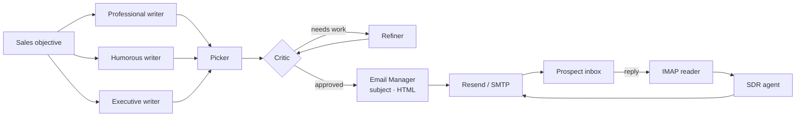

# AI Sales SDR

**A multi-agent sales development representative that writes, critiques, refines and sends cold emails, then holds a real conversation with prospects who reply.**

AI Sales SDR is built on the [OpenAI Agents SDK](https://github.com/openai/openai-agents-python). Several AI writers with different styles draft competing emails. The best draft is chosen and improved through a critic–refiner loop, then sent as a polished HTML email through Resend. When the prospect replies, an SDR agent reads the reply from your inbox and answers it in the same email thread.

The demo company is **ComplAI**, a fictional SaaS product for SOC 2 compliance. You can rebrand it by editing the agent instructions.


---

## Features

- **Competing writers.** Professional, humorous and executive-style sales agents draft emails in parallel.
- **Best-of-N selection.** A picker agent chooses the strongest draft.
- **Critic–refiner loop.** A critic scores the email with structured feedback, and a refiner rewrites it until it is approved or the round limit is reached.
- **Three orchestration strategies,** selectable at runtime:
  - **Via Code:** Python controls the workflow deterministically.
  - **Via LLM:** a Sales Manager agent uses the writers, critic and refiner as tools and decides the flow itself.
  - **Via Handoff:** the Sales Manager drafts, then hands off to an Email Manager that writes the subject, converts the body to HTML and sends it.
- **Real email delivery** through Resend, with automatic SMTP fallback and correct threading headers (`Message-ID`, `In-Reply-To`, `References`).
- **Autonomous reply handling.** The inbox is polled over IMAP, and quoted text and the app's own messages are ignored. The SDR agent replies in the same thread for several turns.
- **Flexible conversation testing.** The prospect's reply can come from your real inbox, from an AI-simulated prospect, or from text you type.
- **Live agent visibility.** The web UI streams every agent step and shows an HTML preview of the email.
- **Dry-run mode.** Run the whole pipeline without sending anything.
- **Tracing.** Every run is traced in the OpenAI platform dashboard.

---

## How it works



### Agents

| Agent | Responsibility |
|---|---|
| Professional / Humorous / Executive Sales Agent | Draft cold emails in distinct voices |
| Sales Picker | Selects the most effective draft |
| Email Critic | Scores the draft and returns structured feedback |
| Email Refiner | Rewrites the draft based on that feedback |
| Subject Writer | Writes a compelling subject line |
| HTML Converter | Turns plain text into a clean HTML email |
| Email Manager | Formats and sends the final email |
| Sales Manager | Orchestrates the writers and reviewers (LLM and handoff modes) |
| SDR Agent | Answers prospect replies within the thread |
| Prospect Simulator | Plays a realistic prospect for testing |

---

## Getting started

### Prerequisites

- Python 3.12+
- [uv](https://docs.astral.sh/uv/)
- An OpenAI API key
- A [Resend](https://resend.com) API key and/or an email account with an app password (for SMTP/IMAP)

### Installation

```bash
git clone https://github.com/<your-username>/ai-sales-sdr.git
cd ai-sales-sdr
cp .env.example .env    # add your keys
uv sync
```

### Run

```bash
uv run app.py                          # web app (default)
uv run app.py --mode code              # code orchestration in the terminal
uv run app.py --mode llm               # LLM orchestration in the terminal
uv run app.py --mode full              # send, then wait for real replies
uv run app.py --mode full --simulate   # an AI plays the prospect
```

In the web app:

1. Pick a ready-made objective or write your own.
2. Choose an orchestration mode. Untick **Send for real** for a dry run.
3. Watch the agents work and review the HTML preview.
4. Continue the conversation with a real inbox reply, a simulated prospect, or your own text.

---

## Configuration

| Variable | Required | Description |
|---|---|---|
| `OPENAI_API_KEY` | ✅ | OpenAI API key |
| `RESEND_API_KEY` | | Resend API key; if empty, SMTP is used |
| `RESEND_FROM` | | Sender, e.g. `ComplAI <onboarding@resend.dev>` |
| `PROSPECT_EMAIL` | | Recipient of the cold email |
| `EMAIL_ADDRESS` | | Inbox that receives replies (also used as `Reply-To`) |
| `EMAIL_APP_PASSWORD` | | App password for IMAP/SMTP |
| `EMAIL_SMTP_SERVER` | | e.g. `smtp.gmail.com` |
| `IMAP_SERVER` | | Optional; derived from the SMTP server when empty |

When the sender is `onboarding@resend.dev`, Resend only delivers to your own Resend account address. Verify a domain to email anyone else.

For Gmail, enable 2-step verification and create an [app password](https://myaccount.google.com/apppasswords) for IMAP/SMTP access.

---

## Tech stack

**OpenAI Agents SDK** (agents, tools, handoffs, structured outputs, tracing) · **Gradio 6** · **Resend** · **IMAP/SMTP** · **Pydantic** · **asyncio**

---

## Responsible use

This project is meant for demos and for prospects who expect to hear from you. Follow anti-spam laws (CAN-SPAM, GDPR, PECR) and get consent before emailing real prospects at scale.

---

## License

Released under the MIT License.
