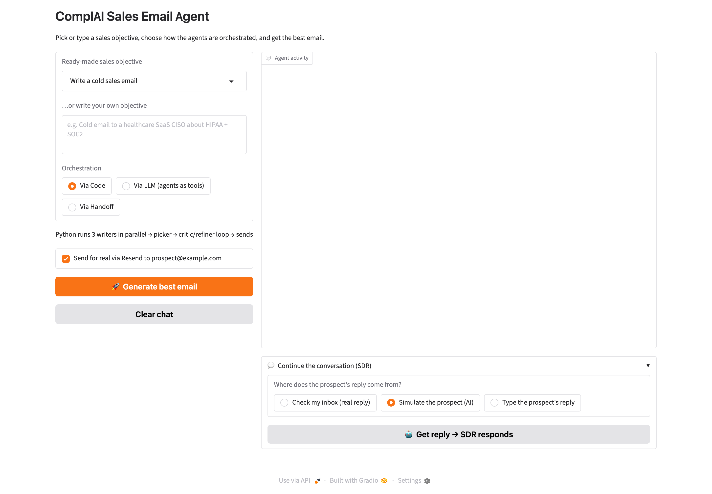
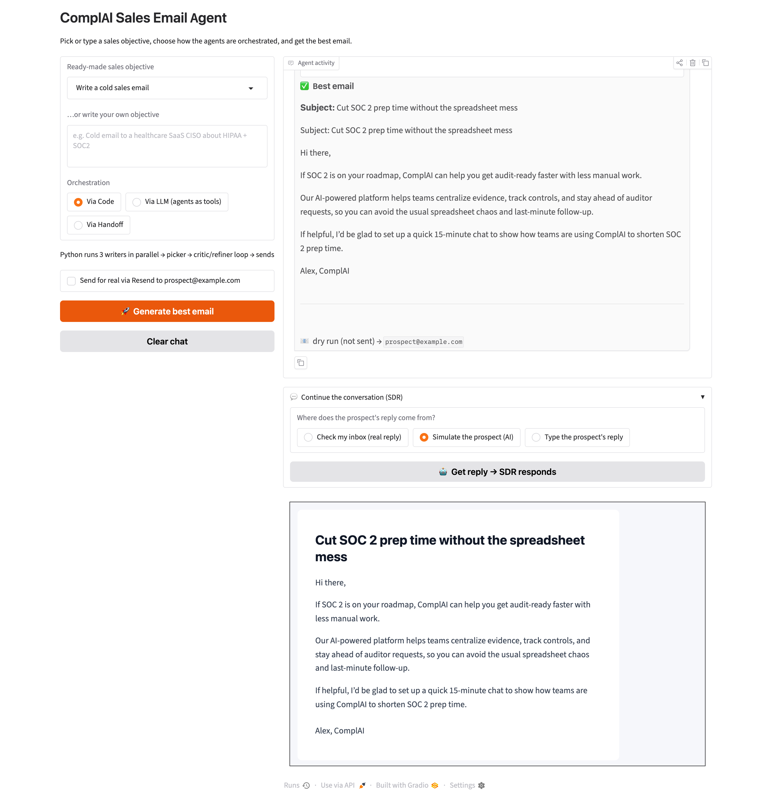
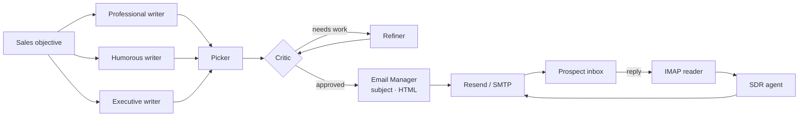

# AI Sales SDR

**A multi-agent sales development representative that writes, critiques, refines and sends cold emails, then holds a real conversation with prospects who reply.**

AI Sales SDR is built on the [OpenAI Agents SDK](https://github.com/openai/openai-agents-python). Several AI writers with different styles draft competing emails. The best draft is chosen and improved through a critic–refiner loop, then sent as a polished HTML email through Resend. When the prospect replies, an SDR agent reads the reply from your inbox and answers it in the same email thread.

The demo company is **ComplAI**, a fictional SaaS product for SOC 2 compliance. You can rebrand it by editing the agent instructions.


---

## Screenshots

**Start screen.** Pick an objective, choose how the agents are orchestrated, and decide whether to really send.



**After a run.** The agent activity panel streams every step and ends with the best email. Below it are the SDR conversation controls and a live HTML preview of the email exactly as the prospect will see it. This run was a dry run, so nothing was sent.



---

## Features

- **Bring your own LLM.** Run every agent on OpenAI, Claude, Grok, Gemini, Llama and more through OpenRouter, xAI, Gemini or a local Ollama model.
- **Competing writers.** Professional, humorous and executive-style sales agents draft emails in parallel.
- **Best-of-N selection.** A picker agent chooses the strongest draft.
- **Critic–refiner loop.** A critic scores the email with structured feedback, and a refiner rewrites it until it is approved or the round limit is reached.
- **Three orchestration strategies,** selectable at runtime:
  - **Via Code:** Python controls the workflow deterministically.
  - **Via LLM:** a Sales Manager agent uses the writers, critic and refiner as tools and decides the flow itself.
  - **Via Handoff:** the Sales Manager drafts, then hands off to an Email Manager that writes the subject, converts the body to HTML and sends it.
- **Real email delivery** through Resend, with automatic SMTP fallback and correct threading headers (`Message-ID`, `In-Reply-To`, `References`).
- **Autonomous reply handling.** The inbox is polled over IMAP, and quoted text and the app's own messages are ignored. The SDR agent replies in the same thread for several turns.
- **Flexible conversation testing.** The prospect's reply can come from your real inbox, from an AI-simulated prospect, or from text you type.
- **Live agent visibility.** The web UI streams every agent step and shows an HTML preview of the email.
- **Dry-run mode.** Run the whole pipeline without sending anything.
- **Tracing.** Every run is traced in the OpenAI platform dashboard.

---

## How it works



### Agents

| Agent | Responsibility |
|---|---|
| Professional / Humorous / Executive Sales Agent | Draft cold emails in distinct voices |
| Sales Picker | Selects the most effective draft |
| Email Critic | Scores the draft and returns structured feedback |
| Email Refiner | Rewrites the draft based on that feedback |
| Subject Writer | Writes a compelling subject line |
| HTML Converter | Turns plain text into a clean HTML email |
| Email Manager | Formats and sends the final email |
| Sales Manager | Orchestrates the writers and reviewers (LLM and handoff modes) |
| SDR Agent | Answers prospect replies within the thread |
| Prospect Simulator | Plays a realistic prospect for testing |

---

## Getting started

### Prerequisites

- Python 3.12+
- [uv](https://docs.astral.sh/uv/)
- An API key for any supported LLM provider (or a local Ollama install)
- A [Resend](https://resend.com) API key and/or an email account with an app password (for SMTP/IMAP)

### Installation

```bash
git clone https://github.com/<your-username>/ai-sales-sdr.git
cd ai-sales-sdr
cp .env.example .env    # add your keys
uv sync
```

### Run

```bash
uv run app.py                          # web app (default)
uv run app.py --mode code              # code orchestration in the terminal
uv run app.py --mode llm               # LLM orchestration in the terminal
uv run app.py --mode full              # send, then wait for real replies
uv run app.py --mode full --simulate   # an AI plays the prospect
```

In the web app:

1. Pick a ready-made objective or write your own.
2. Choose an orchestration mode. Untick **Send for real** for a dry run.
3. Watch the agents work and review the HTML preview.
4. Continue the conversation with a real inbox reply, a simulated prospect, or your own text.

---

## Choose your LLM provider

Set `LLM_PROVIDER` in `.env` and add that provider's key. All agents switch together.

| Provider | `LLM_PROVIDER` | Key | Default model |
|---|---|---|---|
| OpenAI | `openai` | `OPENAI_API_KEY` | `gpt-5.4-mini` |
| OpenRouter (Claude, GPT, Grok, Llama, Mistral…) | `openrouter` | `OPENROUTER_API_KEY` | `openai/gpt-5.4-mini` |
| xAI Grok | `grok` | `XAI_API_KEY` | `grok-4.7` |
| Google Gemini | `gemini` | `GEMINI_API_KEY` | `gemini-2.5-flash` |
| Ollama (local) | `ollama` | none | `llama3.2` |

**Using Claude.** The OpenAI Agents SDK talks to OpenAI-style APIs, so Claude runs through OpenRouter:

```bash
LLM_PROVIDER=openrouter
OPENROUTER_API_KEY=sk-or-...
LLM_MODEL=anthropic/claude-haiku-5.5     # or anthropic/claude-sonnet-5.5, anthropic/claude-opus-5.5
```

**Using Grok.**

```bash
LLM_PROVIDER=grok
XAI_API_KEY=xai-...
```

For providers other than OpenAI, the app switches the Agents SDK to the Chat Completions API and caps output tokens (`LLM_MAX_TOKENS`, default 4096). It also turns off tracing when there is no OpenAI key, because traces are uploaded to the OpenAI dashboard. Models that don't support forced tool calls (Claude Opus 5.5, Sonnet 5.5) are handled automatically.

---

## Configuration

| Variable | Required | Description |
|---|---|---|
| `LLM_PROVIDER` | | `openai` (default), `openrouter`, `grok`, `gemini`, `ollama` |
| `LLM_MODEL` | | Override the provider's default model |
| Provider key | ✅ | `OPENAI_API_KEY`, `OPENROUTER_API_KEY`, `XAI_API_KEY` or `GEMINI_API_KEY` |
| `RESEND_API_KEY` | | Resend API key; if empty, SMTP is used |
| `RESEND_FROM` | | Sender, e.g. `ComplAI <onboarding@resend.dev>` |
| `PROSPECT_EMAIL` | | Recipient of the cold email |
| `EMAIL_ADDRESS` | | Inbox that receives replies (also used as `Reply-To`) |
| `EMAIL_APP_PASSWORD` | | App password for IMAP/SMTP |
| `EMAIL_SMTP_SERVER` | | e.g. `smtp.gmail.com` |
| `IMAP_SERVER` | | Optional; derived from the SMTP server when empty |

When the sender is `onboarding@resend.dev`, Resend only delivers to your own Resend account address. Verify a domain to email anyone else.

For Gmail, enable 2-step verification and create an [app password](https://myaccount.google.com/apppasswords) for IMAP/SMTP access.

---

## Deployment

The app ships as a single container. When a host sets `PORT`, it listens on `0.0.0.0:$PORT` (the image defaults to `7860`).

> **Always protect a hosted copy with a login.** Set `APP_USERNAME` and `APP_PASSWORD`, or anyone with the URL can send email from your account and spend your LLM credits. The app prints a warning at startup when it is hosted without them.

| Variable | Purpose |
|---|---|
| `APP_USERNAME`, `APP_PASSWORD` | Login screen in front of the whole app |
| `PORT` | Port to listen on (set automatically by most platforms) |
| everything in `.env.example` | LLM provider, Resend and inbox settings |

### Where to host it

| Platform | Best for | Notes |
|---|---|---|
| **AWS EC2 / Lightsail** | Recommended: no request time limits, full control | Waiting for an inbox reply can take minutes |
| **Railway / Fly.io / Render** | Simple managed containers | Use the `Dockerfile`; prefer Resend over SMTP (some hosts block SMTP ports) |
| **Hugging Face Spaces** | Quick demos | Make the Space **private** or set the login variables |
| **AWS App Runner / Google Cloud Run** | Serverless containers | Fine for generating emails; long "check my inbox" waits can exceed request time limits |

### Run with Docker (any server)

```bash
docker build -t ai-sales-sdr .
docker run -d --name sdr -p 7860:7860 --env-file .env \
  -e APP_USERNAME=admin -e APP_PASSWORD='choose-a-strong-password' ai-sales-sdr
# open http://localhost:7860 and sign in
```

### AWS: EC2 or Lightsail (recommended)

On an Ubuntu instance (2 GB RAM is enough) with ports 80 and 443 open:

```bash
sudo apt-get update && sudo apt-get install -y docker.io git caddy
git clone https://github.com/<your-username>/ai-sales-sdr.git && cd ai-sales-sdr
nano .env                                   # provider key, Resend, inbox, APP_USERNAME, APP_PASSWORD
sudo docker build -t ai-sales-sdr .
sudo docker run -d --restart unless-stopped --name sdr \
  -p 127.0.0.1:7860:7860 --env-file .env ai-sales-sdr

# Free HTTPS for your domain (point an A record at the instance first)
echo 'sdr.yourdomain.com {
  reverse_proxy 127.0.0.1:7860
}' | sudo tee /etc/caddy/Caddyfile
sudo systemctl reload caddy
```

AWS restricts outbound mail on port 25, but this app sends through Resend's HTTPS API, or SMTP on port 587, so it is not affected.

### AWS: App Runner (managed)

1. Build for `linux/amd64` and push to Amazon ECR:

   ```bash
   AWS_REGION=us-east-1
   ACCOUNT=$(aws sts get-caller-identity --query Account --output text)
   REPO=$ACCOUNT.dkr.ecr.$AWS_REGION.amazonaws.com/ai-sales-sdr

   aws ecr create-repository --repository-name ai-sales-sdr --region $AWS_REGION
   aws ecr get-login-password --region $AWS_REGION | docker login --username AWS --password-stdin $ACCOUNT.dkr.ecr.$AWS_REGION.amazonaws.com
   docker buildx build --platform linux/amd64 -t $REPO:latest --push .
   ```

2. Open **App Runner → Create service → Amazon ECR**, set the port to **7860**, and add your environment variables, including `APP_USERNAME` and `APP_PASSWORD`. Store keys in **AWS Secrets Manager**.
3. Deploy and open the HTTPS URL App Runner gives you.

Email generation fits comfortably within App Runner's request limits. For long inbox waits, use the EC2 option or the **Simulate the prospect** / **Type the prospect's reply** modes.

### Hugging Face Spaces

1. Create a **private** Space with **SDK: Docker**.
2. Push this repository. The Space's `README.md` must start with:

   ```yaml
   ---
   title: AI Sales SDR
   sdk: docker
   app_port: 7860
   ---
   ```

3. Add your keys and `APP_USERNAME` / `APP_PASSWORD` under **Settings → Variables and secrets**.

---

## Tech stack

**OpenAI Agents SDK** (agents, tools, handoffs, structured outputs, tracing) · **OpenRouter / xAI / Gemini / Ollama** · **Gradio 6** · **Resend** · **IMAP/SMTP** · **Pydantic** · **asyncio**

---

## Responsible use

This project is meant for demos and for prospects who expect to hear from you. Follow anti-spam laws (CAN-SPAM, GDPR, PECR) and get consent before emailing real prospects at scale.

---

## License

Released under the MIT License.
